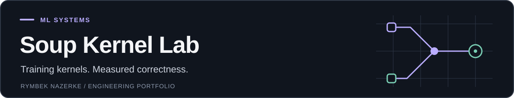

<a id="soup-kernel-lab"></a>

<p>
  
</p>

[](https://github.com/nazek52/soup-kernel-lab/actions/workflows/ci.yml)

Самостоятельный проект по оптимизации обучения языковой модели: собственные Triton-ядра **RMSNorm и cross-entropy**, проверка значений и градиентов, воспроизводимая CPU-демонстрация и notebook для полного Soup benchmark.

CPU-демо и проверки арифметики доступны в репозитории. GPU-производительность и качество полного обучения пока не измерены; конкурсная подача не заявляется.

**Python · PyTorch · Triton · numerical validation**

[Демо](#запустить-демо-за-несколько-команд) · [Устройство проекта](docs/START_HERE_RU.md) · [Проверки](docs/VALIDATION.md) · [Notebook](notebooks/kaggle_cpu_demo_executed.ipynb)

---

## Запустить демо за несколько команд

Нужен Python 3.11 или 3.12. API-ключи и GPU для демо не нужны.

```bash
git clone https://github.com/nazek52/soup-kernel-lab.git
cd soup-kernel-lab
python -m venv .venv
```

Windows PowerShell:

```powershell
.venv\Scripts\python.exe -m pip install torch --index-url https://download.pytorch.org/whl/cpu
.venv\Scripts\python.exe -m pip install -e ".[dev]"
.venv\Scripts\python.exe -m soup_lab demo --open
```

Linux/macOS:

```bash
.venv/bin/python -m pip install torch --index-url https://download.pytorch.org/whl/cpu
.venv/bin/python -m pip install -e ".[dev]"
.venv/bin/python -m soup_lab demo --open
```

Отчёт появится в `reports/demo/index.html`, числа в `result.json`, SHA-256 в `manifest.json`.
Повторный запуск: укажите новый каталог, например `--output reports/demo-2`.
Существующие результаты не перезаписываются.

Демо сравнивает **математический PyTorch-прототип** разбиения cross-entropy на блоки
с обычным PyTorch на словарях 257, 4099 и 151936 классов. Это реальный расчёт
ошибки loss/градиента на CPU, а не замер Triton или обучение модели.

## Что реализовано

| Собственное ядро | Назначение |
|---|---|
| ce_tile_lse | Log-sum-exp для блоков словаря по 4096 элементов |
| ce_row_loss | Объединение блоков и loss целевого класса |
| ce_tile_backward | Градиент без сохранения отдельной полной матрицы log-softmax |
| rms_forward | RMSNorm с float32-редукцией и порядком преобразований типов Qwen |
| rms_backward | Градиент входа RMSNorm с замороженным весом |

Код: [kernels.py](solution/kernels.py), autograd и патчи: [ops.py](solution/ops.py).
Патчи идемпотентны. CPU и неподдерживаемые случаи используют исходные операции PyTorch.
Обучаемые веса RMSNorm сохраняют градиенты через запасной путь.

SwiGLU из официального starter сохранён с атрибуцией и **не считается нашим вкладом**.
Метрики entropy, accuracy и rewind не отключаются. Полные logits остаются нужны
остальным метрикам, поэтому не вся память большого словаря может быть устранена.

## Проверки

[GitHub CI: успешно](https://github.com/nazek52/soup-kernel-lab/actions/runs/41710054016).
20 CPU-тестов прошли; отдельно 10 тестов Triton interpreter прошли.
20 CUDA-тестов не запускались.


```bash
python -m soup_lab doctor
python -m pytest solution dev_tests -q
python -m ruff check soup_lab dev_tests scripts solution/ops.py solution/kernels.py solution/test_candidate.py
```

GitHub Actions запускает CPU-тесты и отдельно исполняет настоящие тела Triton-ядер
через официальный интерпретатор на CPU. Такой тест проверяет арифметику и индексы,
но не CUDA-компиляцию, гонки или скорость GPU.

Linux, для повторения интерпретатора:

```bash
python -m pip install triton==3.4.0
TRITON_INTERPRET=1 python -m pytest dev_tests/test_interpreter.py -q
```

На CUDA:

```bash
python -m soup_lab gpu-test
```

Команда явно завершится ошибкой, если CUDA отсутствует. Пропуски GPU-тестов не выдаются за PASS.

## Полное обучение на Kaggle T4

Импортируйте [notebooks/kaggle_submission.ipynb](notebooks/kaggle_submission.ipynb)
в Kaggle, включите **GPU T4 x2** и **Internet**, затем Run All.
URL этого репозитория уже задан. Notebook устанавливает фиксированные зависимости,
запускает base и solution, сохраняет настоящие результаты и останавливается при ошибке.

Используется только одна T4. Приватные ключи не нужны для этого публичного репозитория.
Необязательный HF_TOKEN задаётся через Kaggle Secrets.
CPU-версия успешно выполнена на Kaggle (24.6 секунды):
https://www.kaggle.com/code/loolaey/soup-kernel-lab-cpu-demo?scriptVersionId=365396899

Kaggle-версия приватная: сервис требует телефон для публичного доступа;
по выбору владельца проверка телефона не выполнялась.
[Скачанный выполненный notebook с настоящими outputs](notebooks/kaggle_cpu_demo_executed.ipynb)
доступен публично в этом репозитории. Он не заменяет полный T4-бенчмарк.

Linux с T4:

```bash
python -m pip install -r requirements.txt
python -m soup_lab benchmark
```

Задача фиксирована: Soup 0.77.0, Qwen2.5-1.5B-Instruct, NF4, LoRA rank 16,
256 инструкций, 64 шага. `harness/`, `task/` и `tests/` не изменены.

| Проверка полного эксперимента | Статус |
|---|---|
| Полное время и пик GPU памяти | Не измерены |
| Качество адаптера | Не измерено |
| Доля собственных ядер ≥5% | Не измерена |
| 10 официальных проверок | Не запускались |

## Готовые материалы

- [Презентация PowerPoint, 6 слайдов](artifacts/Soup_Kernel_Lab.pptx)
- [Демо-видео с русской озвучкой, 2:39](artifacts/Soup_Kernel_Lab_Demo.mp4)
- [HTML-демо: скачайте и откройте](artifacts/CPU_Demo.html)
- [Результаты Kaggle в JSON](evidence/kaggle-cpu-result.json)
- [Выполненный CPU notebook](notebooks/kaggle_cpu_demo_executed.ipynb)

## Материалы и объяснение

- [Как устроен проект и как его показать](docs/START_HERE_RU.md)
- [Протокол фактических проверок](docs/VALIDATION.md)
- [Сценарий демонстрации](docs/DEMO_SCRIPT_RU.md)
- [Описание для сдачи](SUBMISSION.md)

## Ограничения и происхождение

CE специализируется на fp32 CUDA logits и индексах классов, без весов/label smoothing.
RMSNorm поддерживает замороженный fp32 вес, fp16/bf16/fp32 вход и ширину до 8192.
Double backward собственных ядер не поддерживается. GPU-выгода не гарантируется:
порог 5% может не быть достигнут, а стоимость launch может ухудшить время.

Основа: [официальный Soup Kernel Challenge](https://github.com/MakazhanAlpamys/soup-kernel-challenge),
commit `c7c2fcd15972ce8b898d8d3ff732ee192c817ceb`.
[Оригинальный README](docs/OFFICIAL_STARTER_README.md) сохранён.
Новые ядра и инструменты подготовлены с помощью Codex. Математика: log-sum-exp,
производная softmax и RMSNorm. Интеграция сверена с transformers v5.16.1.

Apache-2.0 для кода, исходные LICENSE/NOTICE сохранены. Лицензии данных и модели
указаны в оригинальном README. Модель и данные скачиваются при запуске, не хранятся в Git.

Это самостоятельная реализация по материалам конкурса. Дедлайн Decentrathon 6.0 был
31 октября 2026, 23:59, Астана. Проект создан после дедлайна; конкурсная сдача не заявляется.
